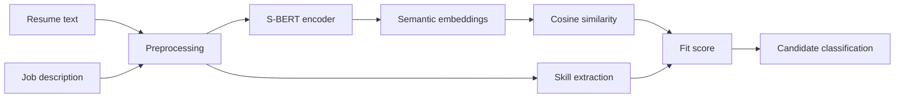

# Resume Analyser & Classifier

An NLP portfolio project for analysing resumes, extracting skills and computing semantic fit against job descriptions using an S-BERT integration path.

## Features
- resume text cleaning and skill extraction
- cosine similarity utilities
- lazy S-BERT embedding engine using `sentence-transformers`
- deterministic lexical fallback for lightweight demos/tests
- candidate-fit scoring and classification
- tests, CI, architecture and technical report

## Architecture


## Quick test
```bash
python -m unittest discover -s tests -v
python demo.py
```

## Enable S-BERT
```bash
pip install -r requirements-ml.txt
```

The default code keeps S-BERT loading lazy so the repository can run unit tests without downloading a large model. When installed, `SBERTEncoder` uses `sentence-transformers/all-MiniLM-L6-v2` by default.

## Responsible use
This prototype supports screening/analysis experiments only. It should not autonomously reject applicants. Real hiring use requires validated job-related criteria, bias testing, accessibility review, privacy controls and human oversight.
