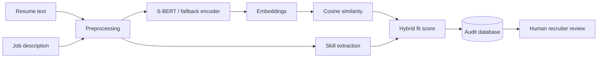

# Resume Analyser & Classifier

A complete NLP portfolio system for cleaning resume text, extracting skills, computing semantic fit against job descriptions, classifying match strength and persisting an auditable screening history.

## Included
- resume text cleaning and skill extraction
- cosine similarity utilities
- lazy S-BERT encoder using `sentence-transformers/all-MiniLM-L6-v2`
- deterministic lexical fallback for lightweight CI/tests
- hybrid semantic + skill-fit scoring
- SQLite persistence for resumes, jobs, skills, matches and audit events
- ER/data-flow diagrams
- automated NLP and storage tests
- CI
- interface, deployment, privacy/fairness and model-card docs
- full technical report

## Architecture


## Quick test
```bash
python -m unittest discover -s tests -v
python demo.py
```

## Enable S-BERT
```bash
pip install -r requirements-ml.txt
```

## Database
```bash
python -c "from src.storage import init_db; init_db('resume_analyser.db', seed=True)"
```

## Responsible use
This project supports analysis experiments only. It must not autonomously reject applicants. Real hiring use requires validated job-related criteria, fairness testing, accessibility review, privacy controls, candidate notice/consent where required and human oversight.
