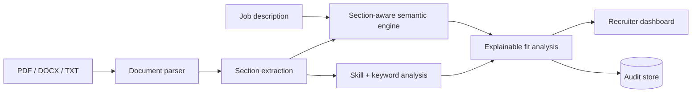

# Resume Analyser & Classifier

**Status: Active portfolio product · Explainable recruitment analytics**

[](https://github.com/rsswethaa/resume-analyser-classifier/actions/workflows/ci.yml)

**[Live Demo](https://swethaa-resume-analyser.onrender.com) · [Architecture](docs/ARCHITECTURE.md) · [Security](SECURITY.md) · [Model Card](docs/MODEL_CARD.md)**

## The problem

Keyword-only resume filters are brittle. A candidate can describe relevant experience using different wording, while a high keyword count can still hide weak evidence or missing experience.

This project compares resumes with a real job description using **section-aware semantic similarity, skills analysis and explainable evidence signals**. The goal is to help a reviewer understand *why* a candidate appears aligned rather than output an unexplained ranking.

## What it does

- parses PDF, DOCX and TXT resumes
- compares multiple candidates in one run
- extracts education, experience, skills, projects and certifications
- calculates section-aware semantic similarity
- uses optional Sentence-BERT (`all-MiniLM-L6-v2`)
- falls back to deterministic lexical similarity in lightweight environments
- reports matched and missing skills
- identifies job-keyword gaps and experience evidence
- produces an explainable candidate ranking
- stores model/version and scoring audit information
- exposes recruiter-facing web and JSON interfaces
- runs in Docker with automated tests and CI

## Why semantic similarity?

Exact keyword matching can miss relevant paraphrases. Sentence-BERT can recognise meaning-level similarity between a job description and resume section, while the deterministic fallback keeps the project reproducible in CI and environments where the heavier model is unavailable.

The semantic score is only one input. The product also surfaces skills, missing requirements, section coverage and supporting evidence so reviewers can inspect the reasoning.

## Architecture



## API

- `POST /api/compare` — job description + up to 10 resumes
- `GET /api/audit` — model/version and aggregate scoring audit
- `GET /health` — health check

## What the dashboard explains

For each candidate the application shows:

- overall score and classification
- semantic similarity
- skill coverage
- matched and missing skills
- keyword gaps
- detected resume sections
- experience evidence
- section-level scores
- encoder/model version
- a plain-language explanation of the ranking

## Key engineering decisions

### Section-aware comparison instead of one giant text block

Education, experience, projects and skills carry different kinds of evidence. Keeping sections separate makes the explanation more useful and reduces the chance that one dense section dominates the entire document comparison.

### Optional model + deterministic fallback

The product can use Sentence-BERT when available, but tests and lightweight deployment do not depend on downloading a large model. This keeps CI predictable while preserving a realistic semantic path.

### Auditability over opaque automation

Model version, scoring inputs and ranking evidence are persisted so a reviewer can inspect what produced an output. This is more appropriate for hiring-related software than returning only a score.

## Run locally

```bash
python -m venv .venv
source .venv/bin/activate  # Windows: .venv\Scripts\activate
pip install -r requirements.txt
python app.py
```

Optional Sentence-BERT support:

```bash
pip install -r requirements-ml.txt
```

Docker:

```bash
docker build -t resume-intelligence .
docker run -p 5000:5000 resume-intelligence
```

## Responsible-use boundary

This project is recruitment decision support, **not an autonomous hiring system**. It does not claim hiring accuracy, job-performance prediction or fairness certification.

Protected demographic variables are intentionally excluded, but that alone does not establish fairness. Real deployment would require representative outcome testing, job-related validation, privacy controls, accessible alternatives, human review and legal assessment.

See [SECURITY.md](SECURITY.md) and [docs/MODEL_CARD.md](docs/MODEL_CARD.md) for the detailed boundary.

## Limitations

- parsing quality depends on document structure
- semantic similarity is not the same as job suitability
- missing information can look like missing experience
- the current score is a portfolio decision-support heuristic, not a validated selection model
- production hiring use would require much stronger governance and evaluation

## Why I built it

The project explores a practical NLP question: how can document similarity become **more explainable and auditable** than a simple keyword count while still keeping human judgement at the centre?
