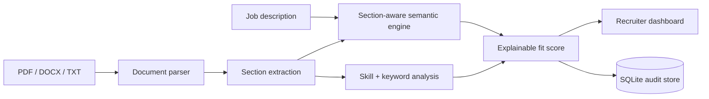

# Resume Analyser & Classifier

[](https://github.com/rsswethaa/resume-analyser-classifier/actions/workflows/ci.yml)

A recruiter-facing NLP product for parsing PDF/DOCX/TXT resumes, extracting sections and skills, comparing multiple candidates with a real job description, and producing explainable section-aware rankings with an audit trail.

## Product features
- PDF, DOCX and TXT resume upload
- multi-candidate comparison in one run
- education, experience, skills, projects and certification section extraction
- optional S-BERT semantic similarity using `all-MiniLM-L6-v2`
- deterministic lexical fallback for CI/lightweight demos
- matched and missing skills
- job keyword gaps
- section-aware semantic scores
- experience evidence detection
- explainable candidate ranking
- recruiter dashboard
- SQLite audit trail with encoder/model version
- fairness/audit summary that explicitly reports scoring inputs
- Docker packaging, health endpoint and automated tests

## Architecture


## Run
```bash
python -m venv .venv
source .venv/bin/activate  # Windows: .venv\Scripts\activate
pip install -r requirements.txt
python app.py
```
Open `http://127.0.0.1:5000`.

### Enable S-BERT
```bash
pip install -r requirements-ml.txt
```
The model remains lazy-loaded; without it the same product uses a deterministic fallback.

### Docker
```bash
docker build -t resume-intelligence .
docker run -p 5000:5000 resume-intelligence
```

## API
- `POST /api/compare` — multipart job description + up to 10 resumes
- `GET /api/audit` — model/version and aggregate scoring audit
- `GET /health` — health check

## What the dashboard explains
For every candidate it shows overall score, classification, semantic similarity, skill coverage, matched skills, missing skills, keyword gaps, detected sections, experience evidence, section-level scores, encoder version and a plain-language ranking reason.

## Structure
```text
app.py                 Flask recruiter product
templates/, static/     dashboard UI
src/document_parser.py  PDF/DOCX/TXT ingestion
src/product_analyser.py section-aware NLP and ranking
src/product_storage.py  audit persistence
src/sbert_engine.py     optional Sentence-BERT
src/analyser.py         core hybrid match logic
database/               schema, seed and reporting SQL
notebooks/              NLP exploration
tests/                  core, storage and product tests
docs/                   architecture, API, database, product, fairness/security, deployment and report
```

## Responsible use
This project is screening/analysis decision support, not an autonomous hiring authority. Protected demographic attributes are intentionally excluded, but that alone does not establish fairness. Production use needs representative bias/outcome testing, accessible alternatives, privacy controls, human review and legal assessment.

## Integrity note
No hiring-performance or accuracy percentage is fabricated. The repository separates implemented functionality from future validation work.
