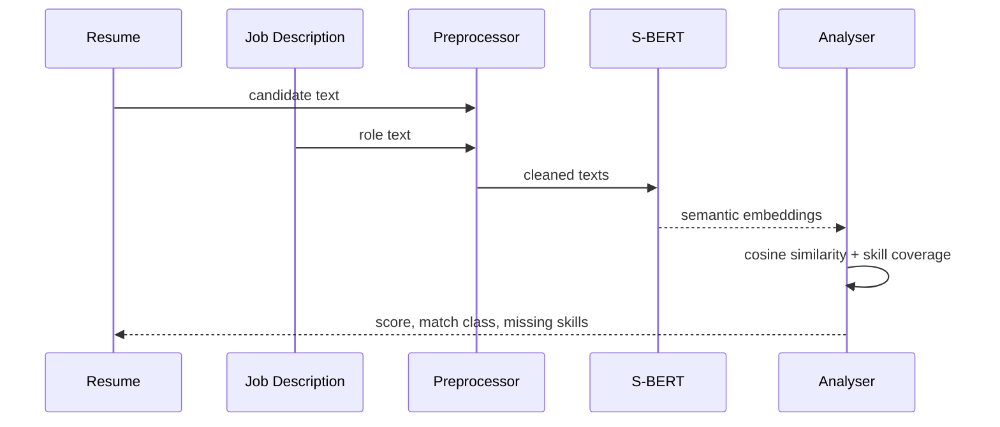

# Architecture

`SBERTEncoder` is a lazy wrapper around `sentence-transformers`. Unit tests use the deterministic lexical path to avoid network/model downloads in CI; semantic similarity can be supplied from S-BERT during a full run.
