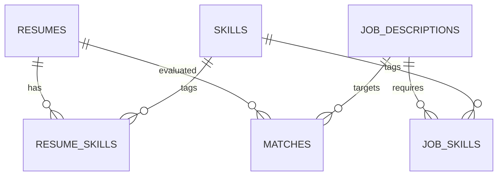

# Database Design

## Tables
- `resumes`: candidate reference and resume text.
- `job_descriptions`: role reference/title/text.
- `skills`: normalised skill catalogue.
- `resume_skills` / `job_skills`: many-to-many explainability links.
- `matches`: semantic, skill and final score plus encoder version.
- `audit_events`: creation/scoring event history.

A production system should store the minimum necessary applicant data, encrypt sensitive content and enforce deletion/retention rules.
