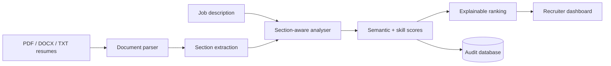

# Product Design — Recruiter Dashboard

## Business use case
The product helps a recruiter or candidate compare resumes with a real job description while retaining explainability. It parses common document formats, identifies sections and job-related skills, computes semantic alignment, highlights gaps and records the scoring trail for audit.

## Flow

## Explainability
Each candidate result exposes semantic similarity, skill coverage, matched skills, missing skills, keyword gaps, section scores, detected experience evidence and the encoder version. Ranking does not use protected demographic attributes.

## Fairness boundary
Excluding protected attributes is not proof of fairness because proxies can exist in resume text and historical job criteria can themselves be biased. Production use therefore requires representative outcome testing, human review, accessible alternatives, candidate notice and legal review.

## What I learned
- parsing heterogeneous business documents
- section-aware NLP instead of treating a resume as one text blob
- combining semantic similarity with explicit skills for explainability
- designing multi-candidate ranking with an audit trail
- keeping S-BERT optional so CI remains reproducible
